**sDMD** - *Version 0.99*
===================

# Discontinuous Molecular Dynamics (DMD) Simulation Package

**Reference & Citing**

If you use this code in your academic work, please cite:

- Zheng, S.; Javidpour, L.; Sahimi, M.; Shing, K. S.; Nakano, A."sDMD: An open source program for discontinuous molecular dynamics simulation of protein folding and aggregation"*Comput. Phys. Commun.* 2020, 247, 106873-106886.
- Zheng, S.; Sajib, M. S. J.; Wei, Y.; Wei, T.
  "Discontinuous Molecular Dynamics Simulations of Biomolecule Interfacial Behavior: Study of Ovispirin-1 Adsorption on a Graphene Surface"
  *J. Chem. Theory Comput.* 2021, 17 (3), 1874-1882.

**Table of Contents**
=================

+ [Introduction](#introduction)
+ [What Is New in This Version](#what-is-new-in-this-version)
+ [Units](#units)
+ [Models and Interactions](#models-and-interactions)

  + [Models](#models)

    + [Intermediate-resolution Coarse Grained Model](#intermediate-resolution-coarse-grained-model)
    + [High-resolution All-atom Model](#high-resolution-all-atom-model)
  + [Interactions](#interactions)

    + [Algorithms](#algorithms)
    + [Energy Minimization](#energy-minimization)
    + [Confined Walls](#confined-walls)
    + [Replica Exchange Molecular Dynamics Simulation (REMD)](#replica-exchange-molecular-dynamics-simulation-remd)
+ [Program Structure](#program-structure)

  + [Data Structures](#data-structures)
  + [The Event Loop](#the-event-loop)
  + [How the Program Stays Fast](#how-the-program-stays-fast)
+ [Program Usage](#program-usage)

  + [Installation](#installation)
  + [Parameters](#parameters)

    + [Non-REMD simulation](#non-remd-simulation)
    + [REMD Simulation](#remd-simulation)
    + [Analysis](#analysis)
+ [Format](#format)

  + [Coordinate File](#coordinate-file)

    + [GRO File](#gro-file)
    + [PDB File](#pdb-file)
  + [Force Field Files](#force-field-files)

    + [FF_Info.txt](#ff_infotxt)
    + [Residue Files](#residue-files)
    + [Potential Tables](#potential-tables)
  + [Output Files](#output-files)
+ [Functions](#functions)

  + [Simulation Source Code](#simulation-source-code)
  + [Analysis Source Code](#analysis-source-code)


**Introduction**
============

Discrete molecular dynamics (DMD) is a very fast alternative to traditional molecular dynamics. It was first introduced in 1959 by Alder and Wainwright<sup id="c11"></sup> to simulate hard spheres. Rapaport<sup id="c12"></sup> later used it to simulate polymer chains, and today it is widely used for proteins and other polymers. Because it is so fast, it suits large systems and long time scales.

In DMD, the force between two particles is replaced by a *step function* of their distance *r* (see Figure *1-1*). The potential energy is flat between steps, so no force acts on a particle until two particles reach the distance of a step. When that happens we call it an *event*. Between events, every particle moves in a straight line at constant velocity. At an event, we know exactly how much the potential energy changes, so the new velocities follow directly from conservation of momentum and energy. The simulation therefore jumps from one event to the next instead of taking many small time steps. This makes the code quite different from traditional molecular dynamics: most of the work goes into predicting, ordering and checking events, and into the explicit hydrogen-bond mechanism.


*Figure 1-1 DMD potentials: (a) hard-sphere collision, (b) attractive square well, (c) repulsive soft sphere, (d) covalent bond and auxiliary bond.*

*sDMD* is a simulation package based on DMD, with a high-resolution all-atom molecular model. It is written in C from scratch and has been heavily optimized. New molecules can be added by writing new parameter and potential files; the code itself does not need to change. Both the simulation program and the analysis program are controlled by one easy-to-read configuration file and a few command-line flags.

The package can simulate:

- NVT (constant temperature) and NVE (constant energy) ensembles
- systems in bulk
- systems in confined spaces such as parallel plates, cylindrical tubes and spherical cavities
- walls that expand, compress or pulse during the simulation
- molecules flowing through a tube between two reservoirs
- replica exchange molecular dynamics (REMD)

The analysis program can:

- remove periodic boundary conditions from a trajectory
- count the different types of hydrogen bonds
- compute Ramachandran plots
- compute contact maps between pairs of atoms and pairs of amino acids
- compute the temperature, kinetic energy and potential energy
- compute the radius of gyration and the RMSD to a reference structure
- compute density profiles and pore-size distributions
- count clusters during aggregation
- analyze REMD data with the weighted histogram analysis method (WHAM)

This manual explains the theory behind DMD, the molecular models and the interaction algorithms. It also describes how the program is organized, what each source file does, and how to install and use the package.


*Reference*

<b id="c11">[1]</b> Alder, B. J.; Wainwright, T. E., Studies in Molecular Dynamics. I. General Method. *The Journal of Chemical Physics* **1959,** *31* (2), 459-466.[↩](#c11)

<b id="c12">[2]</b> Rapaport, D. C., Molecular dynamics simulation of polymer chains with excluded volume. *Journal of Physics A: Mathematical and General* **1978,** *11* (8), L213.[↩](#c12)

<b id="c12">[3]</b> Rapaport, D. C., Molecular dynamics study of a polymer chain in solution. *The Journal of Chemical Physics* **1979,** *71* (8), 3299-3303.[↩](#c12)

<b id="c12">[4]</b> Rapaport, D., The event scheduling problem in molecular dynamic simulation. *Journal of Computational Physics* **1980,** *34* (2), 184-201.[↩](#c12)


**What Is New in This Version**
===========================

This version is a heavily optimized release of sDMD. The main changes are as follows:

- **Much faster on large systems.** The program no longer moves every atom after every event. It only moves the atoms that take part in an event, and the event calendar stores absolute times, so nothing has to be updated for all atoms at each step. On a 7,400-atom system an event costs about 7.8 µs, compared with 36 µs before (about 4.6× faster). Very small systems, such as a single 10-residue peptide, gain little, because there almost every atom is a neighbour of every other atom.
- **Adjustable neighbour cells.** The box can be cut into smaller cells (`-cell 1`, `2` or `3`). The program picks a size by itself. Smaller cells help dense systems such as proteins in explicit water (about 1.4× faster), not proteins in vacuum.
- **Backup events.** Each atom remembers a few alternative future events. When its next event is cancelled, the program can often use a backup instead of searching the neighbourhood again (about 1.1–1.2× faster).
- **Updated force field.** The backbone–backbone hydrogen-bond strength is scaled by 0.806, as in the original authors' parameter files. Each class of hydrogen bond can now have its own scale factor.
- **Choice of parameter folder.** The new `FF_Library` option in *parameter.txt* selects which library folder to read.
- **Safer data files.** The binary files *SysInfo.dat* and *savedData.dat* now start with a format version, so newer programs can still read older files. The analysis program was brought up to date with all simulation output.
- **Reproducible runs.** `-seed N` fixes the random number seed.


**Units**
=====

*Table 2-1 Basic units*

| **Quantity** | **Symbol** | **Unit**                                                                                      |
| ------------------ | ---------------- | --------------------------------------------------------------------------------------------------- |
| length             | L                | Å = 10<sup>-10</sup> m                                                                             |
| mass               | m                | u (atomic mass unit) = 1.6605402(10) x 10<sup>-27</sup> kg (1/12 the mass of a <sup>12</sup>C atom) |
| energy             | E                | kcal mol<sup>-1</sup> = 4.184 kJ mol<sup>-1</sup>                                                   |
|                    |                  |                                                                                                     |

*Table 2-2 Derived units*

| **Quantity** | **Symbol** | **Unit**                                                                  |
| ------------------ | ---------------- | ------------------------------------------------------------------------------- |
| time               | t                | about 48.88 fs = 48.88 x 10<sup>-15</sup> s                                     |
| velocity           | v                | Å (48.88 fs)<sup>-1</sup> ≈ 2.05 x 10<sup>3</sup> m s<sup>-1</sup>            |
| temperature        | T                | (1 kcal mol<sup>-1</sup>) / *k<sub>B</sub>* ≈ 503.2 K                        |
| force              | F                | kcal mol<sup>-1</sup> Å<sup>-1</sup> = u Å (48.88 fs)<sup>-2</sup> ≈ 69.5 pN |
|                    |                  |                                                                                 |

The temperature in *parameter.txt* is a *reduced* temperature, *T\** = *k<sub>B</sub>T* / (1 kcal mol<sup>-1</sup>). For example, *T\** = 0.6 is about 300 K.

*Table 2-3 Constants*

| **Symbol**  | **Name**       | **Unit**                                                     |
| ----------------- | -------------------- | ------------------------------------------------------------------ |
| *N<sub>A</sub>* | Avogadro's number    | 6.0221367(36) x 10<sup>23</sup> mol<sup>-1</sup>                   |
| *k<sub>B</sub>* | Boltzmann's constant | 1.987204118 x 10<sup>-3</sup> kcal mol<sup>-1</sup> K<sup>-1</sup> |
|                   |                      |                                                                    |
|                   |                      |                                                                    |
|                   |                      |                                                                    |

**Models and Interactions**
=======================

This section describes the molecular models and the interaction algorithms used in sDMD.

**Models**
------

sDMD can use protein models from low-resolution coarse-grained models to the high-resolution all-atom model. The current library uses the all-atom model; earlier versions used a coarse-grained model. The two share many ideas. Users can add their own molecules to the library by following the file format in [Format](#format); the source code does not need to change.

We first describe the low-resolution model and then the high-resolution model.

### **Intermediate-resolution Coarse Grained Model**

Earlier versions of sDMD used an intermediate-resolution coarse-grained model called PRIME, developed by Smith and Hall<sup id="c31"></sup>. It reproduces the backbone geometry correctly and has been very successful in reproducing several experimentally measured features of proteins in bulk. In PRIME, every amino acid is represented by four beads: N, C<sub>α</sub>, C, and R (see *Figure 3-1*). The N bead represents the amide nitrogen and its hydrogen; the C<sub>α</sub> bead the α-carbon and its hydrogen; the C bead the carbonyl carbon and oxygen; and the R bead the side chain, which is given the diameter of CH<sub>3</sub> (alanine). The peptide bond is kept in the *trans* configuration. All backbone bond lengths and bond angles, and the distance between consecutive C<sub>α</sub> beads, are fixed at their experimental values. *Table 3-1* lists the parameters. Water is NOT included explicitly; its effect is built into the energy function as a potential of mean force.

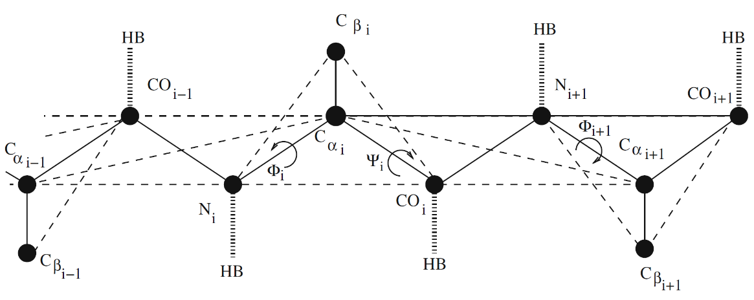

*Figure 3-1 The four-bead model of the protein backbone. Bold lines show covalent bonds, dashed lines show auxiliary bonds that help keep the backbone geometry, and thick broken lines show possible hydrogen bonds.<sup id="c35"></sup>*

*Table 3-1 Parameter values for the proteins used in the DMD simulations*

| **Beads** | **Diameter (Å)** |
| --------------- | ----------------------- |
| N               | 3.300                   |
| C<sub>α</sub>  | 3.700                   |
| C               | 4.000                   |
| R               | 4.408                   |
|                 |                         |

| **Bonds**                  | **Length (Å)** |
| -------------------------------- | --------------------- |
| N<sub>i</sub>-C<sub>α,i</sub>   | 1.460                 |
| C<sub>α,i</sub>-N<sub>i+1</sub> | 1.510                 |
| C<sub>i</sub>-N<sub>i+1</sub>    | 1.330                 |
| C<sub>α,i</sub>-R<sub>i</sub>   | 1.531                 |
|                                  |                       |

| **Auxiliary Bonds**           | **Length (Å)** |
| ----------------------------------- | --------------------- |
| N<sub>i</sub>-C<sub>i</sub>         | 2.450                 |
| C<sub>α,i</sub>-N<sub>i+1</sub>    | 2.410                 |
| C<sub>i</sub>-C<sub>α,i+1</sub>    | 2.450                 |
| C<sub>α,i</sub>-C<sub>α,i+1</sub> | 3.800                 |
| N<sub>i</sub>-R<sub>i</sub>         | 2.440                 |
| C<sub>i</sub>-R<sub>i</sub>         | 2.490                 |
|                                     |                       |

| **Bond Angles**                              | **Angle (deg)** |
| -------------------------------------------------- | --------------------- |
| ∠N<sub>i</sub>-C<sub>α,i</sub>-C<sub>i</sub>     | 111.0                 |
| ∠C<sub>α,i</sub>-C<sub>i</sub>-N<sub>i+1</sub>   | 116.0                 |
| ∠C<sub>i</sub>-N<sub>i+1</sub>-C<sub>α,i+1</sub> | 122.0                 |
| ∠R<sub>i</sub>-C<sub>α,i</sub>-C<sub>i</sub>     | 109.6                 |
| ∠R<sub>i</sub>-C<sub>α,i</sub>-N<sub>i</sub>     | 110.1                 |
|                                                    |                       |

Beads feel five kinds of forces at events: (1) infinite repulsion when two beads touch (hard-sphere collision), (2) infinite attraction that keeps beads joined by covalent and auxiliary bonds within a range, (3) attraction between backbone beads when a hydrogen bond forms, (4) attraction between hydrophobic side chains, and (5) repulsion between beads next to a hydrogen bond (soft-sphere collision). All of them can be written as step functions:

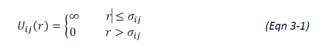

This is the hard-sphere potential. *r* is the distance between beads *i* and *j*; *sigma<sub>ij</sub>* is the sum of the bead radii.

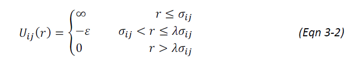

This is a square well or a shoulder, depending on the sign of *epsilon* (positive: a well, attractive; negative: a shoulder, repulsive). *lambda sigma<sub>ij</sub>* is the width of the well or shoulder.

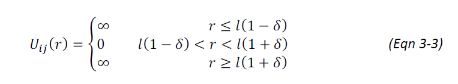

This is a bond. *l* is the bond length and *delta* is how much the bond may stretch or shrink.

As Takada et al.<sup id="c36"></sup> pointed out, two beads that are very close along the chain interact more like the real atoms than like the large beads. For example, neighbouring carbonyl carbons should use the diameter of a carbon atom, not of the whole C bead. So beads separated by three or fewer bonds may overlap by up to 25% of their diameters, and beads separated by four bonds by up to 15%.

Backbone beads, and C<sub>α</sub> and R beads, are joined by covalent bonds. A bond may move freely between *l(1 - delta)* and *l(1 + delta)*; here *delta* = 0.02375. Auxiliary bonds between next-nearest beads along the backbone hold the bond angles. For example, an auxiliary bond between N<sub>i</sub> and C<sub>i</sub> in *Figure 3-1* keeps the N<sub>i</sub>-C<sub>α,i</sub>-C<sub>i</sub> angle near its ideal value. Auxiliary bonds between neighbouring C<sub>α</sub> beads keep their distance near the experimental value. Together, the C<sub>α,i</sub>-N<sub>i+1</sub>, C<sub>i</sub>-C<sub>α,i+1</sub> and C<sub>α,i</sub>-C<sub>α,i+1</sub> auxiliary bonds and the C<sub>α,i</sub>-C<sub>i</sub>, C<sub>i</sub>-N<sub>i+1</sub> and N<sub>i+1</sub>-C<sub>α,i+1</sub> covalent bonds keep the peptide group (C<sub>α,i</sub>-C<sub>i</sub>-N<sub>i+1</sub>-C<sub>α,i+1</sub>) in the *trans* configuration. Auxiliary bonds between the side chain and the N and C beads fix the side chain relative to the backbone, so every residue is an *L*-isomer.

A hydrogen bond (HB) can form between an N bead and a C bead on the backbone when four conditions are met (see *Figure 3-2*): (1) N<sub>i</sub> and C<sub>j</sub> are 4.2 Å apart; (2) their neighbours, C<sub>i-1</sub> and C<sub>α,i</sub>, C<sub>α,j</sub> and N<sub>j+1</sub>, are in suitable positions; (3) neither N nor C already has a hydrogen bond; (4) N and C are at least three residues apart or on different peptides. For condition (2), the four pairs N<sub>i</sub>-C<sub>α,j</sub>, N<sub>i</sub>-N<sub>j+1</sub>, C<sub>j</sub>-C<sub>α,i</sub> and C<sub>j</sub>-C<sub>i-1</sub> must be farther apart than the distances *d<sub>ij</sub>* in *Table 3-2*. This keeps the hydrogen bond correctly oriented.

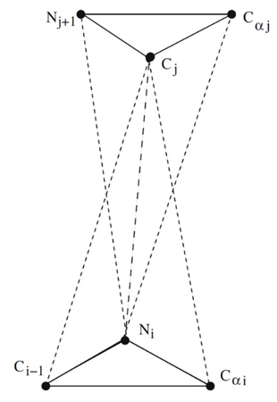

*Figure 3-2 Hydrogen bond in the coarse-grained model. The thick dashed line is the hydrogen bond; thin dashed lines are auxiliary bonds that keep its orientation; bold lines are backbone covalent bonds.*

*Table 3-2 Parameter values for hydrogen bond*

| **Pairs**                | ***d<sub>ij</sub>(Å)*** |
| ------------------------------ | -------------------------------- |
| N<sub>i</sub>-C<sub>α,j</sub> | 5.00                             |
| N<sub>i</sub>-N<sub>j+1</sub>  | 4.74                             |
| C<sub>j</sub>-C<sub>α,i</sub> | 4.86                             |
| C<sub>j</sub>-C<sub>i-1</sub>  | 4.83                             |
|                                |                                  |

When N<sub>i</sub> and C<sub>j</sub> come to 4.2 Å, the program checks the four auxiliary pairs and adds up the change in potential energy. Depending on the orientation, it can be -*epsilon<sub>HB</sub>*, *0*, *epsilon<sub>HB</sub>*, 2*epsilon<sub>HB</sub>* or 3*epsilon<sub>HB</sub>*. If the pair has enough kinetic energy to pay for this change, the bond forms: N<sub>i</sub> and C<sub>j</sub> become new bead types N<sub>i</sub>' and C<sub>j</sub>', and from then on they interact with each other using the parameters of the new types (their other interactions do not change). Otherwise they keep their types and bounce off each other like hard spheres.

Thermal motion distorts the hydrogen bond, and a large enough distortion can break it. When N<sub>i</sub>' and C<sub>j</sub>' come back to exactly 4.2 Å, the program checks the energy change in the same way and decides whether the bond breaks; if so, the beads change back to N<sub>i</sub> and C<sub>j</sub>.

To keep the temperature near its target (NVT ensemble), sDMD uses the Andersen thermostat.<sup id="c37"></sup> Every bead now and then collides with an invisible "ghost" particle of the same mass. After such a collision the bead gets a new random velocity drawn from the Maxwell-Boltzmann distribution at the target temperature. How often this happens is set by `Thermo_Freq` in *parameter.txt*.

Water is not included explicitly. Its effect is modelled by a square-well attraction (a potential of mean force) between hydrophobic side-chain beads. Each R bead is marked "H" (hydrophobic) or "P" (polar). Two "H" beads attract each other at a distance of 1.5*sigma<sub>ij</sub>*, as long as they are at least three residues apart or on different peptides. Pairs involving a "P" bead only collide as hard spheres.

### **High-resolution All-atom Model**

To use sDMD on more complex systems, the model was upgraded from coarse-grained to all-atom. Much of the code was rewritten to make it more modular and efficient. The library file format is described in [Format](#format).

The all-atom model was developed by Ding et al.<sup id="c38"></sup>. Thanks to Dr. Ding, we use the updated parameter files (the values printed in the paper are outdated). The ideas are the same as in the coarse-grained model: auxiliary bonds hold the shape of the molecule, and all forces are step functions. But now every atom is explicit, except some non-polar hydrogens (see *Figure 3-3*), and the step functions follow the real continuous potentials more closely (*Figure 3-4(a)*). Because each potential has several steps, most interactions now have both an attractive and a repulsive part, unlike the coarse-grained model, which had only one or the other. There is also a new kind of interaction, the dihedral constraint. It is also an auxiliary bond, but its potential has several steps (*Figure 3-4(b)*).

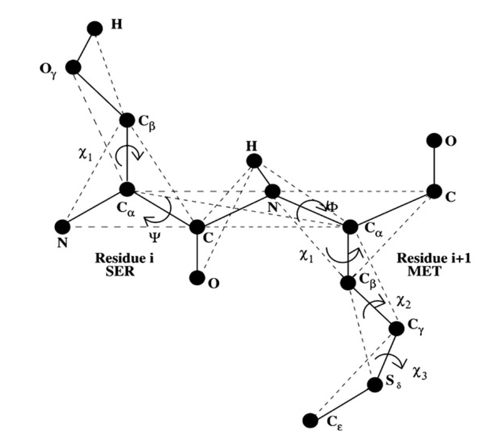

*Figure 3-3 The all-atom protein model. Solid lines are covalent bonds and dashed lines are auxiliary bonds.*

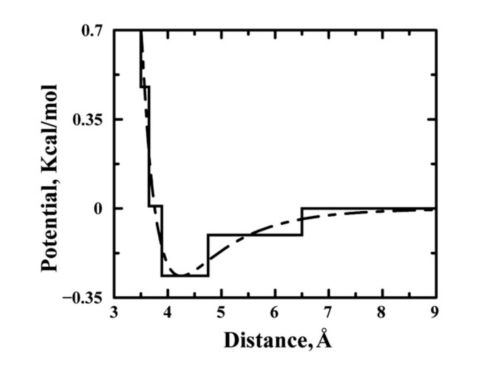
(a)

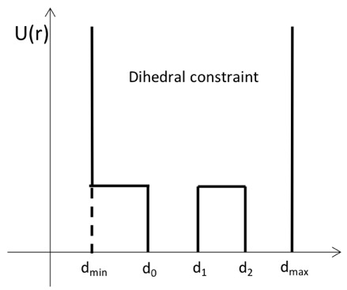
(b)

*Figure 3-4 (a) Non-bonded interaction in the all-atom model. The dashed curve is the continuous van der Waals plus solvation interaction between two carbon atoms; the solid step function is the DMD version. (b) Potential of a dihedral constraint.*

Because oxygen and hydrogen atoms are explicit, the hydrogen bond is also modelled in more detail, see *Figure 3-5*.

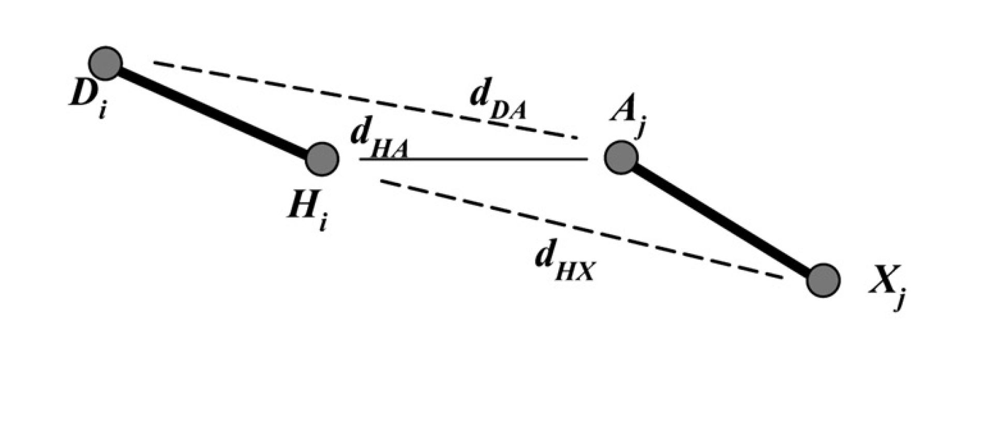

*Figure 3-5 Hydrogen bond in the all-atom model. H<sub>i</sub> is the hydrogen; A<sub>j</sub> is the acceptor, which can be different kinds of atoms; D<sub>i</sub> is the donor, the heavy atom bonded to H<sub>i</sub>; X<sub>j</sub> is the heavy atom bonded to A<sub>j</sub>. Thick solid lines are covalent bonds; the thin solid line is the hydrogen bond; dashed lines are auxiliary bonds that keep its orientation.*

Depending on the type of A<sub>j</sub>, hydrogen bonds can form between two backbones, between backbone and side chain, or between two side chains. Donors are the backbone amide hydrogens and the polar side-chain hydrogens of His, Trp, Tyr, Asn, Gln, Arg and Lys. Acceptors are backbone carbonyl oxygens, the side-chain oxygens of Asp, Glu, Ser, Thr and Tyr, and the side-chain nitrogen of His.

Forming and breaking a hydrogen bond works like in the coarse-grained model:

1. When H<sub>i</sub> and A<sub>j</sub> reach the bonding distance, the program checks the H<sub>i</sub>-X<sub>j</sub> and D<sub>i</sub>-A<sub>j</sub> distances, which describe the bond's orientation.
2. It computes the total change in potential energy between H<sub>i</sub>, A<sub>j</sub> and all surrounding atoms, before and after the bond would form.
3. If the orientation is acceptable and the pair has enough kinetic energy to pay for the change, the bond forms. H<sub>i</sub> and A<sub>j</sub> become new atom types H<sub>i</sub>' and A<sub>j</sub>' and use the potentials for those types from then on.

Hydrogen bonds are grouped into three classes (backbone–backbone, backbone–side chain, side chain–side chain). Each class has its own scale factor at the top of *HBPotentialTable.txt*. Backbone–backbone bonds are scaled by 0.806, as in the authors' parameter files.

**Interactions**
------------

This part describes the basic DMD algorithm, followed by energy minimization, walls and REMD.

### **Algorithms**

Here we describe how DMD works.

Take two particles, *i* and *j*, each with diameter *sigma*. Their positions are the vectors *vector_r<sub>i</sub>* = [x<sub>i</sub>,y<sub>i</sub>,z<sub>i</sub>] and *vector_r<sub>j</sub>* = [x<sub>j</sub>,y<sub>j</sub>,z<sub>j</sub>], and their velocities are *vector_v<sub>i</sub>* and *vector_v<sub>j</sub>*. Whether and when they collide can be found from their relative position and relative velocity, *vector_r<sub>ij</sub>* and *vector_v<sub>ij</sub>*.

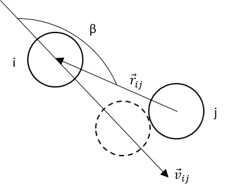

*Figure 3-6 A collision between two atoms (in 2D)*

A collision happens if the distance between *i* and *j* will at some future time equal the average diameter *sigma<sub>ij</sub> = (sigma<sub>i</sub> + sigma<sub>j</sub>) / 2*. Writing the starting values with a superscript "*o*", the relative position at any later time is:

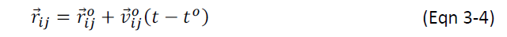

If *vector_r<sub>ij</sub>* and *vector_v<sub>ij</sub>* point in opposite directions, the particles are approaching and may collide. We check whether *vector_r<sub>ij</sub> ∙ vector_r<sub>ij</sub>* will equal *sigma<sub>ij</sub><sup>2</sup>* after some time *(t - t<sup>o</sup>)*:

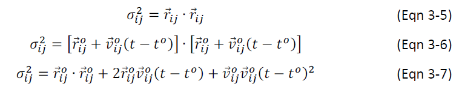

We define *b<sub>ij</sub>* as the dot product:


If *b<sub>ij</sub>* > *0*, the particles are moving apart. If *b<sub>ij</sub>* = *0*, the relative velocity is perpendicular to the line between them. If *b<sub>ij</sub>* < *0*, they are getting closer and may collide. Dropping the superscript "*o*", the equation above becomes:

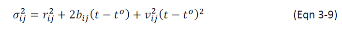

or

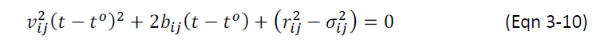

Solving this quadratic equation for the time gives:

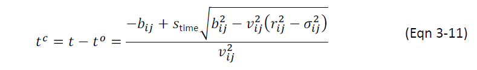

where *s<sub>time</sub> = ±1*. The term under the square root, *b<sub>ij</sub><sup>2</sup> - v<sub>ij</sub><sup>2</sup>(r<sub>ij</sub><sup>2</sup> - sigma<sub>ij</sub><sup>2</sup>)*, must not be negative for a collision to happen; if it is negative, the particles miss each other. The smaller root, *s<sub>time</sub> = -1*, is the physical one (*Figure 3-7*): the particles touch at *vector_r<sub>j</sub><sup>s-</sup>*. The other root, *vector_r<sub>j</sub><sup>s+</sup>*, would be reached only if the particles could pass through each other.

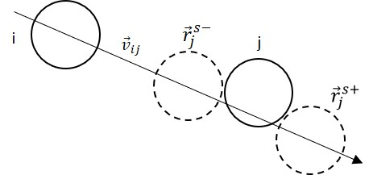

*Figure 3-7 Only the smaller root, s<sub>time</sub> = -1, is used.*

When the potential has steps (shells, see *Figure 3-8*), the event time is found the same way:

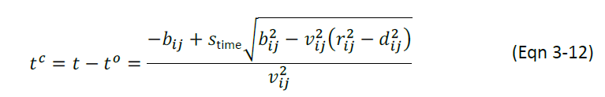

where *d<sub>ij</sub>* is the distance of the step where the event happens.

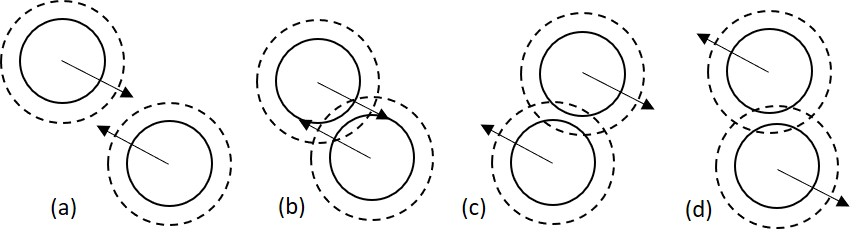

*Figure 3-8 (a) Particles approaching that will enter a shell; (b) particles inside a shell that will collide as hard spheres; (c) particles inside a shell that miss each other and reach the shell edge on the way out; (d) particles moving apart that will cross a step on the way out.*

Finding the new velocities after an event takes a bit more work. A prime (') marks values after the event. The change in potential energy is *Δepsilon = epsilon' - epsilon*. It is zero for a hard-sphere collision, and positive or negative when the particles cross a step.

Total energy is conserved at the event:

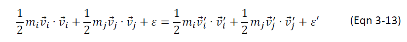

which can be rearranged to:

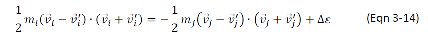

At the moment of the event, the relative position is:

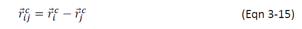

The change in momentum points along the line between the particles, *vector_r<sub>ij</sub><sup>c</sup>*:

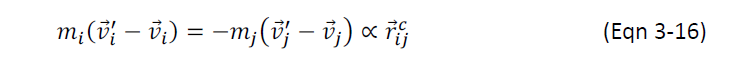

or

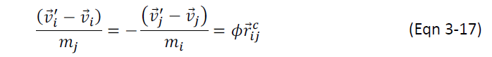

*phi* is the unknown we want to find. Putting this into the energy equation gives:

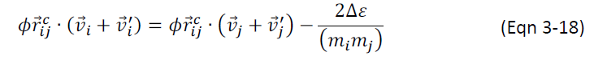

The momentum equation can also be rearranged to:

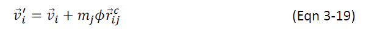

and

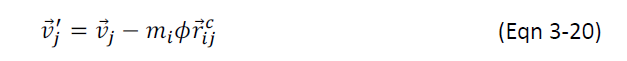

Putting these two into the energy equation removes the primed (after-event) velocities:

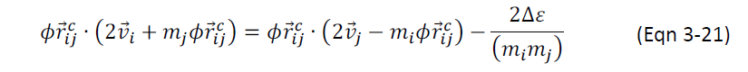

We define *d<sub>ij</sub><sup>2</sup> = vector_r<sub>ij</sub><sup>c</sup> ∙ vector_r<sub>ij</sub><sup>c</sup>*, *vector_v<sub>ij</sub> = vector_v<sub>i</sub> - vector_v<sub>j</sub>* and *b<sub>ij</sub><sup>c</sup> = vector_r<sub>ij</sub><sup>c</sup> ∙ vector_v<sub>ij</sub>*, and rearrange:

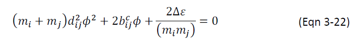

Solving this quadratic equation:

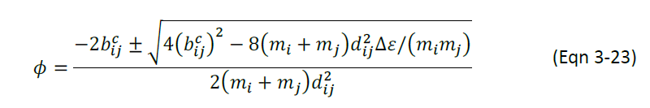

With the reduced mass, , this becomes:

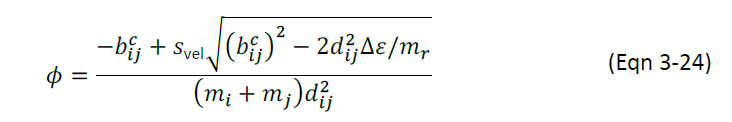

The sign *s<sub>vel</sub>* depends on the type of event (*Figure 3-9*). When *Δepsilon* = *0*, only *s<sub>vel</sub>* = *-1* makes physical sense. For a hard-sphere collision, *d<sub>ij</sub>* = *sigma<sub>ij</sub>* and the result simplifies to:

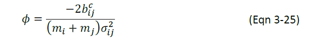

Each kind of event is handled as shown in this flow chart:

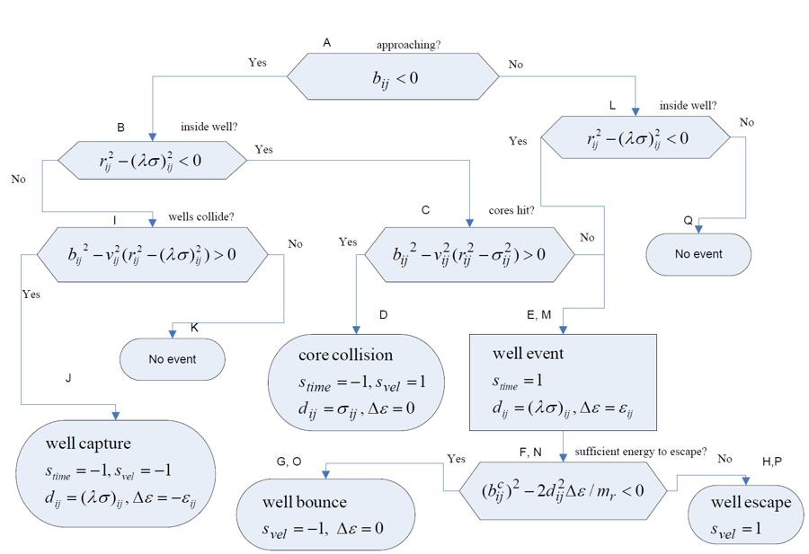

*Figure 3-9 Flow chart for DMD with wells.<sup id="c39"></sup>*

### **Energy Minimization**

sDMD can in principle start from any protein PDB file. The coordinates in such a file may break the allowed bond-length ranges or put atoms closer than the library allows. To fix this, sDMD first runs a steepest-descent energy minimization.

A step function has no slope, so the usual gradient cannot be used. Instead, for each pair of atoms the program looks at which step they are on and in which direction the energy goes down, and moves the atoms that way.

To keep this fast, the minimization only fixes bonds that are too short or too long and atoms that overlap. You can relax the structure further with a short run at low temperature.

The minimized structure is written to *MiniEnergy.gro* **in the input folder** (it overwrites any existing file). If you run several simulations at the same time, give each one its own copy of the input folder so they do not overwrite each other's file.

### **Confined Walls**

sDMD can simulate a system in confined spaces such as between parallel plates, inside a cylindrical tube or inside a spherical cavity. These walls are smooth surfaces without explicit atoms. A wall works like a set of layers, one layer per potential step.

Parallel plates are simple: once the wall positions are set, the time when an atom reaches a wall layer is easy to compute, and only the velocity component perpendicular to the wall changes. It is a one-dimensional problem.

A tube or a sphere is harder. Because the surface is curved and has no atoms, it is not obvious where on the wall an atom will hit, yet that is needed for both the energy and the new velocity.

sDMD solves this indirectly (*Figure 3-10*). It is easy to compute the distance *L* from an atom to the centre (axis) of the tube or cavity. The distance from the atom to the wall is then *D = R - L*, where *R* is the radius of the tube or cavity, and *D* tells which wall layer the atom is in. The program then treats the wall as one huge pseudo-atom at the centre, and the atom as moving inside that pseudo-atom's shell. The event types are simply swapped: entering a well of the pseudo-atom becomes leaving the wall's well, a hard-sphere collision becomes a bounce at the wall, and so on. This way the same code handles atom–atom and atom–wall events.

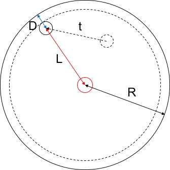

*Figure 3-10 Wall interaction in a cylindrical tube or a spherical cavity. The big solid circle is the wall, which cannot be crossed; the big dashed circle is the edge of the wall's potential. The small black dashed circle is the atom now; the small black solid circle is the atom after time t. The small red circle is the pseudo-atom at the centre. The black line is the radius of the wall, R; the red line is the distance from the atom to the pseudo-atom, L; the blue line is the distance from the atom to the wall, D = R - L.*

sDMD also supports *obstruction walls*: flat, impenetrable walls parallel to the *xy*, *xz* or *yz* plane. Any number of them can be placed anywhere in the box. They can be used to close the ends of a tube, build box-shaped confinements, divide the box into regions, or, together with the tunnel option, build a tube between two reservoirs (*Figure 3-11*).

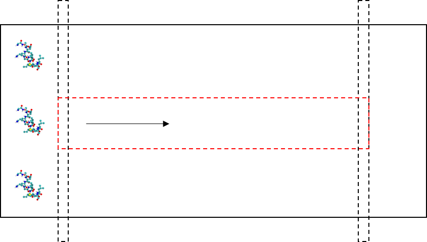

*Figure 3-11 Obstruction walls combined with a cylindrical tube make a tube between two reservoirs, which can be used to model protein translocation. The solid rectangle is the edge of the simulation box; the black dashed rectangles are obstruction walls; the red dashed rectangle is the cylindrical tube.*

### **Replica Exchange Molecular Dynamics Simulation (REMD)**

sDMD can run REMD. The results can be analyzed with T-WHAM<sup id="c310"></sup> in the analysis program.

REMD helps a simulation explore the energy landscape of a molecule. At low temperature a molecule can get stuck in a local energy minimum for a long time. At high temperature it escapes easily, but the high-temperature landscape is not the one we care about. REMD combines the two<sup id="c38"></sup><sup>,</sup><sup id="c312"></sup>.

Several copies (replicas) of the same system run at the same time, each at a different temperature. Every so often, two replicas *i* and *j*, at temperatures T<sub>i</sub> and T<sub>j</sub> and with energies E<sub>i</sub> and E<sub>j</sub>, try to swap temperatures. The swap is accepted with the Metropolis probability: *P* = *1* if , and *P* = *e<sup>-Δ</sup>* if *Δ* > *0*. When a swap is accepted, each replica simply continues with the new target temperature; velocities are not rescaled, and the thermostat brings the replica to its new temperature. The replicas exchange their temperatures and energies through a small socket server, *sServer*. A swap every 1000 time units is a good starting point.


*Reference*

<b id="c31">[1]</b> Voegler Smith, A.; Hall, C. K., alpha-helix formation: discontinuous molecular dynamics on an intermediate-resolution protein model. *Proteins* **2001,** *44* (3), 344-60.[↩](#c31)

<b id="c31">[2]</b> Voegler Smith, A.; Hall, C. K., Bridging the gap between homopolymer and protein models: A discontinuous molecular dynamics study. *The Journal of Chemical Physics* **2000,** *113* (20), 9331-9342.[↩](#c31)

<b id="c31">[3]</b> Smith, A. V.; Hall, C. K., Assembly of a tetrameric alpha-helical bundle: computer simulations on an intermediate-resolution protein model. *Proteins* **2001,** *44* (3), 376-91.[↩](#c31)

<b id="c31">[4]</b> Smith, A. V.; Hall, C. K., Protein refolding versus aggregation: computer simulations on an intermediate-resolution protein model. *J Mol Biol* **2001,** *312* (1), 187-202.[↩](#c31)

<b id="c35">[5]</b> Buldyrev, S. V., Application of Discrete Molecular Dynamics to Protein Folding and Aggregation. In *Aspects of Physical Biology: Biological Water, Protein Solutions, Transport and Replication*, Franzese, G.; Rubi, M., Eds. Springer Berlin Heidelberg: Berlin, Heidelberg, 2008; pp 97-131.[↩](#c35)

<b id="c36">[6]</b> Takada, S.; Luthey-Schulten, Z.; Wolynes, P. G., Folding dynamics with nonadditive forces: A simulation study of a designed helical protein and a random heteropolymer. *J. Chem. Phys.* **1999,** *110* (23), 11616-11629.[↩](#c36)

<b id="c37">[7]</b> Andersen, H. C., Molecular dynamics simulations at constant pressure and/or temperature. *The Journal of Chemical Physics* **1980,** *72* (4), 2384-2393.[↩](#c37)

<b id="c38">[8]</b> Ding, F.; Tsao, D.; Nie, H.; Dokholyan, N. V., Ab initio folding of proteins with all-atom discrete molecular dynamics.
*Structure* **2008,** *16* (7), 1010-8.[↩](#c38)

<b id="c39">[9]</b> Elliott, J. R.; Lira, C. T., Supplement. In *Introductory chemical engineering thermodynamics*, 2nd ed.; Prentice Hall: Upper Saddle River, NJ, 2012.[↩](#c39)

<b id="c310">[10]</b> Kumar, S.; Rosenberg, J. M.; Bouzida, D.; Swendsen, R. H.; Kollman, P. A., The weighted histogram analysis method for free-energy calculations on biomolecules. I. The method. *Journal of Computational Chemistry* **1992,** *13* (8), 1011-1021.[↩](#c310)

<b id="c310">[11]</b> Gallicchio, E.; Andrec, M.; Felts, A. K.; Levy, R. M., Temperature weighted histogram analysis method, replica exchange, and transition paths. *J Phys Chem B* **2005,** *109* (14), 6722-31.[↩](#c310)

<b id="c312">[12]</b> Zhou, R.; Berne, B. J.; Germain, R., The free energy landscape for beta hairpin folding in explicit water. *Proc Natl Acad Sci U S A* **2001,** *98* (26), 14931-6.[↩](#c312)

<b id="c312">[13]</b> Okamoto, Y., Generalized-ensemble algorithms: enhanced sampling techniques for Monte Carlo and molecular dynamics simulations. *J Mol Graph Model* **2004,** *22* (5), 425-39.[↩](#c312)


**Program Structure**
=================

This section explains how the simulation program is organized. All shared data structures are defined in `src/DMD.h`.

**Data Structures**
---------------

The most important structure is `struct AtomStr`. There is one per atom, and it holds two pointers:

```C
struct AtomStr {
    struct PropertyStr *property;   // things that never change: name, mass, type, bonds ...
    struct DynamicStr  *dynamic;    // things that change: position, velocity, next event ...
};
```

**`PropertyStr`** holds what stays fixed during a run: the atom's name, residue name, mass and charge; its atom type (an atom has an "original" type and a "reacted" type that it uses while it is in a hydrogen bond); and two lists of `ConstraintStr`, one for its bonds and one for its other constraints (auxiliary bonds and dihedral constraints).

**`DynamicStr`** holds what changes:

- `coordinate` and `velocity`
- `lastUpdateTime`: the simulation time at which this atom's position was last brought up to date (see [How the Program Stays Fast](#how-the-program-stays-fast))
- `cellIndex`: the cell the atom is in
- `HB`: its hydrogen-bond state, including its current partner
- `event`: the atom's next scheduled event: its time, partner and type

**`ConstraintStr`** describes one bonded pair or constrained pair: the partner atom, the smallest and largest allowed distance, and a linked list of potential steps (`StepPotenStr`). Each step stores its distance (squared), the energy change at that step, and the accumulated energy of the shell just inside it. Non-bonded and hydrogen-bond potentials use the same step lists, looked up by the pair's atom types.

The event types (collision, bond, hydrogen bond, thermostat, cell crossing, wall, and so on) are listed in `enum EEventType` and `enum EInteractionType` in `DMD.h`.

**The Event Loop**
--------------

The simulation is one loop, `SingleThreadRun()` in `SGThread.c`. Normal runs and REMD replicas use the same loop. Each pass:

1. **Take the next event.** The event calendar (a complete binary tree, see below) always has the earliest event at its top.
2. **Advance the time** to that event, and bring the atom and its partner up to that time.
3. **Check that the event is still valid** (`HazardCheck()`). An event was predicted some time ago; since then, the atom or its partner may have taken part in another event. If so, the prediction is out of date and is thrown away. The program then uses one of the atom's backup events, if a valid one exists, or predicts a new event.
4. **Carry out the event** (`DoEvent()` in `Events.c`): compute the new velocities, form or break hydrogen bonds, and update cells.
5. **Predict the next event** for the atoms involved (`Predict()`), using the functions in `TimePrediction.c`, and put it into the calendar.
6. **Save output** when it is time to write a frame.

Safety counters stop the run with an error message if the simulation gets stuck, for example if events keep happening at the same moment without time moving forward.

**How the Program Stays Fast**
--------------------------

- **Event calendar.** All upcoming events are stored in a complete binary tree that keeps the earliest event at the top. Event times are stored as absolute times, so after an event only the atoms involved need to be updated in the tree, never all atoms.
- **Positions are updated only when needed.** Between events every atom moves in a straight line, so its position at any time can be computed from its last position and velocity. sDMD therefore does not move all atoms after every event. An atom is moved forward, with `UpdateAtom()`, only when it is needed: when it takes part in an event, when a neighbour needs its position, or when a frame is written. Every piece of code that reads the position of another atom must first bring that atom up to date.
- **Neighbour cells.** The box is divided into cells, and the program records which atoms are in which cell. To find possible partners of an atom, it only looks in the cells around it, within the cut-off distance. By default a cell is as wide as the cut-off (27 cells are searched); with `-cell 2` or `-cell 3` cells are 1/2 or 1/3 of that, which saves work in dense systems.
- **Backup events.** When an atom's next event is predicted, a few runner-up events are kept as well. If the first one becomes invalid, a backup can often be used instead of searching all neighbours again.
- **Short step lists.** Each pair potential has only 3–8 steps, so the program finds the right step by walking the short list. (A large lookup table was tried and turned out slower and much more memory-hungry.)


**Program Usage**
=============

**Installation**
------------

The package has three main folders:

- `src` — the simulation source code
- `analysis` — the analysis source code
- `input` — example input: the configuration file *parameter.txt*, example structures (*ala10.gro*, *insulin.gro*), and the force-field folders `Library_<name>` (for example `Library_Ding`)

Each source folder has its own *Makefile*. The code is written in C99 and needs only `pthreads` and the math library (plus OpenGL if you want live visualization).

To build the simulation programs, run this in the `src` folder:

```bash
$ make all
```

This builds three programs: *sDMD*, the simulation itself; *sREMD*, which starts and manages an REMD simulation; and *sServer*, the small server that the replicas use to talk to each other (sREMD starts it for you).

If you only need normal simulations, build only *sDMD*:

```bash
$ make sDMD
```

To watch the simulation live, install the OpenGL utility library (GLUT) and build with: (Not support anymore)

```bash
$ make sDMD VIS=yes
```

To build the analysis program, run this in the `analysis` folder:

```bash
$ make
```

This builds one program, *sAnalysis*.

**Parameters**
----------

### **Non-REMD simulation**

sDMD needs a coordinate file (*\*.gro* or *\*.pdb*), the configuration file *parameter.txt*, and a force-field folder `Library_<name>`, all in the input folder.

Example *parameter.txt*:

```txt
Continue?          new
Time               2000
Temp               0.4
Dump_Rate          10
CutOff_R           10.0
Force_Field        Ding
Thermostat         Andersen
Thermo_Freq        6.0
CGModel            no no
SurfExist?         no
SurfType           no
WallDyn            no
Flow               no
Obstruct?          no
Tunnel?            no
SphObst?           no
```

| **Item** | **Description**                                                                                                                                                                                                                                                                                                                                                                                                                                                                                                                   |
| -------------- | --------------------------------------------------------------------------------------------------------------------------------------------------------------------------------------------------------------------------------------------------------------------------------------------------------------------------------------------------------------------------------------------------------------------------------------------------------------------------------------------------------------------------------------- |
| Continue?      | `new` starts a new simulation. `continue` extends an earlier run from its saved state (*savedData.dat*). In both cases old output files are kept as backups, with the date and time added to their names.                                                                                                                                                                                                                                                                                                                         |
| Time           | Simulation time, in time units (1 unit ≈ 48.88 fs). With `continue`, this is the new total time.                                                                                                                                                                                                                                                                                                                                                                                                                                     |
| Temp           | Reduced temperature, *T\** = *k<sub>B</sub>T* / (1 kcal/mol), so *T\** = 1 ≈ 503 K. Use `no` to keep the temperature of the previous run (and for REMD).                                                                                                                                                                                                                                                                                                                                                                       |
| Dump\_Rate     | How often a frame is written, in time units.                                                                                                                                                                                                                                                                                                                                                                                                                                                                                            |
| CutOff\_R      | Cut-off distance for non-bonded interactions, in Å.                                                                                                                                                                                                                                                                                                                                                                                                                                                                                    |
| Force\_Field   | The force field and its program logic. Currently `Ding`<sup id="c51"></sup>.                                                                                                                                                                                                                                                                                                                                                                                                                                                          |
| FF\_Library    | (optional) Read parameters from `Library_<name>` instead of `Library_<Force_Field>`.                                                                                                                                                                                                                                                                                                                                                                                                     |
| Thermostat     | `Andersen`<sup id="c52"></sup> for constant temperature (NVT), or `no` for constant energy (NVE).                                                                                                                                                                                                                                                                                                                                                                                                                                   |
| Thermo\_Freq   | How often each atom meets the thermostat, in time units. The time between two thermostat events of one atom is this value times a random number (about 0.8 on average). A larger value means weaker coupling.                                                                                                                                                                                                                                                                                                                           |
| CGModel        | Coarse-grained options (experimental). Use `no no` for normal all-atom runs.                                                                                                                                                                                                                                                                                                                                                                                                                                                          |
| SurfExist?     | `no` for a system in bulk. `implicit` for smooth walls (see SurfType). `explicit` for a surface built from atoms (currently graphene).                                                                                                                                                                                                                                                                                                                                                                                            |
| SurfType       | Shape of an `implicit` wall: `parallel`, `cylinder` or `sphere`. For an `explicit` surface: `graphene`. Use `no` otherwise.                                                                                                                                                                                                                                                                                                                                                                                               |
| WallDyn        | `no` for fixed walls. `compress`, `extend` or `repulse` for walls that move (see the flags `-Wsz` and `-Wrt`).                                                                                                                                                                                                                                                                                                                                                                                                              |
| Flow           | A driving force for flow. `no`, or one of: `velocity vx vy vz` — every atom gets this constant extra velocity (unit 0.02 Å/ps), e.g. `velocity 50.0 0.0 0.0`; `force fx fy fz` — every atom feels this constant force at thermostat events (unit pN), e.g. `force 5.0 0.0 0.0`; `charge n, x y z gradient distance` — *n* fixed charges at positions (x, y, z) that attract or repel charged atoms, with the potential gradient (kcal/mol) and interaction distance (Å), e.g. `charge 1, 150.0 50.0 50.0 1.0 1.0`. |
| Obstruct?      | Obstruction walls. `no`, or the number of walls followed by the axis and position of each wall, separated by commas, e.g. `2, x 50.0, x 150.0`.                                                                                                                                                                                                                                                                                                                                                                                     |
| Tunnel?        | Tunnels, used for translocation. `no`, or the number of tunnels followed by, for each tunnel, the start *x*, end *x*, *y*, *z* and diameter, separated by commas.                                                                                                                                                                                                                                                                                                                                                             |
| SphObst?       | Spherical obstacles. `no`, or the number of obstacles followed by, for each one, its *x*, *y*, *z* and diameter, separated by commas.                                                                                                                                                                                                                                                                                                                                                                                           |
|                |                                                                                                                                                                                                                                                                                                                                                                                                                                                                                                                                         |

To run a simulation:

```bash
$ ./src/sDMD -i input/ -o output/ -f input/ala10.gro
```

Use *-h* or *-help* to list all flags:

| **Flag** | **Description**                                                                                             |
| -------------- | ----------------------------------------------------------------------------------------------------------------- |
| -i             | input folder (with *parameter.txt* and the `Library_<name>` folder)                                           |
| -o             | output folder                                                                                                     |
| -f             | (optional) the coordinate file                                                                                    |
| -seed          | (optional) random number seed, for reproducible runs. Default: taken from the clock.                              |
| -si            | (optional) the saved-state file to continue from                                                                  |
| -so            | (optional) the name of the saved-state file to write                                                              |
| -trj           | (optional) the name of the trajectory file                                                                        |
| -cnt           | (optional) the name of the connection (bond and hydrogen-bond) map file                                           |
| -log           | (optional) the name of the log file                                                                               |
| -sys           | (optional) the name of the system-information file                                                                |
| -pot           | (optional) write the potential energy; optionally followed by a file name                                         |
| -kin           | (optional) write the kinetic energy; optionally followed by a file name                                           |
| -tem           | (optional) write the temperature; optionally followed by a file name                                              |
| -HBn           | (optional) write the number of hydrogen bonds; optionally followed by a file name                                 |
| -xyz           | (optional) also write the trajectory in *.xyz* format; optionally followed by a file name                       |
| -pdb           | (optional) also write the trajectory in *.pdb* format; optionally followed by a file name                       |
| -box           | (needed only for a *.pdb* coordinate file) the box size in *x*, *y* and *z*                               |
| -cell          | (optional) cells per cut-off distance for the neighbour search: 1, 2 or 3. Default 0 = choose automatically       |
| -pre           | (optional) start with the bonds (hydrogen bonds or disulfide bonds) listed in *PreBond.txt* in the input folder |
| -fix           | (optional) keep the atoms listed in *FixedAtoms.txt* in the input folder fixed                                  |
| -Wsz           | (needed only if WallDyn is set) how much the wall size changes, default 5 Å                                      |
| -Wrt           | (needed only if WallDyn is set) how long the size change takes, default 200 time units                            |
| -ter           | (optional) choose the charge state of the termini interactively, instead of charged (default)                     |
| -arg           | (optional) choose the charge state of arginines interactively, instead of charged (default)                       |
| -asp           | (optional) choose the charge state of aspartic acids interactively, instead of charged (default)                  |
| -glu           | (optional) choose the charge state of glutamic acids interactively, instead of charged (default)                  |
| -his           | (optional) choose the charge state of histidines interactively, instead of charged (default)                      |
| -lys           | (optional) choose the charge state of lysines interactively, instead of charged (default)                         |
| -AlC           | (optional) give every atom a charge of +1                                                                         |
| -AlP           | (optional) spread each peptide's net charge evenly over its atoms                                                 |
| -npC           | (optional) the fixed charges of the `charge` flow have no periodic images                                       |
| -COM           | (optional) keep the centre-of-mass velocity of the molecules                                                      |
| -REMD          | used only inside REMD; set automatically by *sREMD*                                                             |
| -visual        | (optional) show the simulation live (needs a `VIS=yes` build)                                                   |
|                |                                                                                                                   |

Every file and folder path may be up to 4096 characters long. The input and output folder names may use up to half of that and file names up to a quarter, so a folder plus a file name always fits.

### **REMD Simulation**

An REMD run needs, besides the files above, the configuration file *REMDConfig.txt* and the programs *sServer* and *sREMD* in the same folder as *sDMD*. Set *Temp* in *parameter.txt* to `no`; each replica gets its temperature from *REMDConfig.txt*.

Example *REMDConfig.txt* (the first line is a comment):

```txt
#REPLICA EXCHANGE MD CONFIGURATION FILE
ReplicaNum              = 3
Temperatures            = 275 350 450
SocketPort              = 20202
ExchangeRate            = 1000
```

| **Item** | **Description**                                       |
| -------------- | ----------------------------------------------------------- |
| ReplicaNum     | Number of replicas.                                         |
| Temperatures   | Temperature of each replica, in K.                          |
| SocketPort     | Port number of the socket server.                           |
| ExchangeRate   | How often replicas try to swap temperatures, in time units. |
|                |                                                             |

Run *sREMD* from the `src` folder. It starts *./sDMD* and *./sServer* from there:

```bash
$ cd src
$ ./sREMD -f ../input/REMDConfig.txt -args -i ../input/ -o ../output/ -f ala10.gro -end
```

| **Flag** | **Description**                                                                  |
| -------------- | -------------------------------------------------------------------------------------- |
| -f             | the REMD configuration file                                                            |
| -args          | the flags passed to every replica's *sDMD* (without *-REMD*), ending with `-end` |
|                |                                                                                        |

*sREMD* adds the *-REMD* flag for each replica and starts *sServer* by itself. Each replica's screen output goes to *outputData_\<n\>.txt* in the folder where *sREMD* was started, and its data files get the replica number in their names. If all replicas stop before finishing, *sREMD* also stops the server.

### **Analysis**

To analyze a simulation:

```bash
$ ./analysis/sAnalysis -path output/ -trj out_trj.gro -cnt out_cnt.txt -rPBC -HB -Ramach
```

Use *-h* or *-help* to list all flags:

| **Flag** | **Description**                                                                         |
| -------------- | --------------------------------------------------------------------------------------------- |
| -path          | the folder with the simulation output                                                         |
| -trj           | the trajectory file                                                                           |
| -cnt           | the connection map file                                                                       |
| -sys           | (optional) the system-information file                                                        |
| -log           | (optional) the log file                                                                       |
| -ref           | (optional) a reference structure, for RMSD                                                    |
| -obs           | (optional) the obstruction-wall information file                                              |
| -nPP           | (optional) analyze only this peptide (by number)                                              |
| -sum           | (optional) analyze all output files in the folder, including continued runs                   |
| -rPBC          | remove periodic boundary conditions. Run this first; needs -trj                               |
| -HB            | hydrogen-bond analysis; needs -cnt                                                            |
| -En            | energies and temperature                                                                      |
| -Ag            | aggregation (cluster counting)                                                                |
| -RG            | radius of gyration                                                                            |
| -RMSD          | root-mean-square deviation from the structure given with -ref (backbone atoms; proteins only) |
| -PotMap        | potential energy as a function of RMSD to two reference structures (needs -ref)               |
| -Ramach        | Ramachandran plot of each amino acid (needs -HB)                                              |
| -ConMap        | contact maps of atoms and of amino acids (needs -HB)                                          |
| -dens          | density profile along `x`, `y` or `z`                                                   |
| -PSD           | pore-size distribution; followed by the number of grid cells in *x*, *y* and *z*        |
| -dis           | distance analysis; currently only `CG2Wall`                                                 |
| -MSD           | mean-square displacement (accepted, but not implemented yet)                                  |
| -REMD          | analyze REMD data, with these extra flags:                                                    |
| -reNo          | number of replicas                                                                            |
| -bin           | (optional) number of histogram bins, default 10                                               |
| -aHB           | (optional) use the number of α-helix hydrogen bonds as the reaction coordinate               |
| -bHB           | (optional) use the number of β-sheet hydrogen bonds as the reaction coordinate               |
| -tHB           | (optional) use the total number of hydrogen bonds as the reaction coordinate                  |
| -rmsd          | (optional) use the RMSD as the reaction coordinate (needs -RMSD and -ref)                     |
| -rate          | (optional) how often frames were written, in time units, default 10                           |
| -temp          | (optional) target temperature, default 300                                                    |
| -st            | (optional) first frame to analyze, default 0                                                  |
| -et            | (optional) last frame to analyze, default -1 (the final frame)                                |
|                |                                                                                               |

The analysis program is modular, so new analyses are easy to add. It reads the binary files written by sDMD (see [Output Files](#output-files)), including files written by older versions.


*Reference*

<b id="c51">[1]</b> Ding, F.; Tsao, D.; Nie, H.; Dokholyan, N. V., Ab initio folding of proteins with all-atom discrete molecular dynamics. *Structure* **2008,** *16* (7), 1010-8.[↩](#c51)

<b id="c52">[2]</b> Andersen, H. C., Molecular dynamics simulations at constant pressure and/or temperature. *The Journal of Chemical Physics* **1980,** *72* (4), 2384-2393.[↩](#c52)


**Format**
======

**Coordinate File**
---------------

sDMD reads *.gro* and *.pdb* coordinate files. We recommend *.gro*, because *.pdb* files come in many variants.

You can convert a *.pdb* file to *.gro* with GROMACS:

```bash
$ gmx pdb2gmx -f coor.pdb -o coor.gro -ignh
```

GROMACS will ask for a force field. Choose a GROMOS force field, because its atom names are the closest to the names used in sDMD. For a protein simulation with the protein library, delete any water molecules from the *.gro* file afterwards and update the total number of atoms on the second line.

When sDMD reads the coordinate file, it removes atoms that are not in the model library, such as non-polar hydrogens and one of the two oxygens at the C-terminus. It then works out the molecules, residues and atoms and stores this information. Some of it can only be finished after the whole file has been read, so the program writes an intermediate *coordinate.xyz* file to the input folder and reads it back.

The trajectory is written in *.gro* format: a series of snapshots of all atom positions, written every *Dump_Rate* time units.

### **GRO File**

Note that coordinates in a *.gro* file are in nm, while sDMD works in Å. The program converts them automatically.

Example *.gro* file:

```txt
model
  375
    1ASP      N    1   1.110   2.333   3.994
    1ASP     CA    2   1.234   2.331   3.919
    1ASP      C    3   1.207   2.279   3.778
    1ASP      O    4   1.143   2.175   3.761
    1ASP     CB    5   1.337   2.238   3.984
    1ASP     CG    6   1.284   2.100   4.023
    1ASP    OD1    7   1.196   2.095   4.111
    1ASP    OD2    8   1.333   2.002   3.964
    2ALA      N    9   1.256   2.353   3.680
    2ALA     CA   10   1.237   2.315   3.540
    2ALA      C   11   1.370   2.330   3.467
    2ALA      O   12   1.476   2.292   3.519
    2ALA     CB   13   1.128   2.403   3.479
    2ALA      H   14   1.308   2.439   3.696
    3GLU      N   15   1.363   2.383   3.346
    3GLU     CA   16   1.482   2.402   3.264
    …
   7.00000   7.00000   7.00000
```

The first line is a comment, for example a short description of the system. Only one comment line is allowed.

The second line is the total number of atoms (375 here; not all are shown).

Each following line describes one atom. Take this line as an example:

```txt
    2ALA     N    9    1.256 2.353 3.680
```

The first field says which residue the atom belongs to: here the second residue, alanine (ALA). Residue numbers start again from 1 for every molecule; this is how the program tells where one molecule ends and the next begins. The second field is the atom name. The third is the atom's number in the whole system, which runs continuously. The last three fields are the *x*, *y* and *z* coordinates. In a trajectory written by sDMD, three more fields follow: the *x*, *y* and *z* velocities.

The last line gives the box size in *x*, *y* and *z*.

### **PDB File**

Example *.pdb* file:

```txt
REMARK    THIS IS A SIMULATION BOX
CRYST1  150.000  150.000  150.000  90.00  90.00  90.00 P 1        1
ATOM      1  N   ASP X   1      60.227  61.745  83.465  0.00  0.00
ATOM      2  CA  ASP X   1      61.467  61.725  82.715  0.00  0.00
ATOM      3  C   ASP X   1      61.197  61.205  81.305  0.00  0.00
ATOM      4  O   ASP X   1      60.557  60.165  81.135  0.00  0.00
ATOM      5  CB  ASP X   1      62.497  60.795  83.365  0.00  0.00
ATOM      6  CG  ASP X   1      61.967  59.415  83.755  0.00  0.00
ATOM      7  OD1 ASP X   1      61.087  59.365  84.635  0.00  0.00
ATOM      8  OD2 ASP X   1      62.457  58.435  83.165  0.00  0.00
ATOM      9  N   ALA X   2      61.687  61.945  80.325  0.00  0.00
ATOM     10  CA  ALA X   2      61.497  61.565  78.925  0.00  0.00
…
END
```

A *.pdb* file can start with several comment lines. Only lines starting with "ATOM" are read. Take this line as an example:

```txt
ATOM      9  N   ALA X   2      61.687  61.945  80.325  0.00  0.00
```

The first field is the keyword. The second is the atom's number in the whole system. The third is the atom name and the fourth the residue name. The fifth is a label for the molecule: all atoms of one molecule share the same label; different molecules may reuse a label, but two neighbouring molecules must not have the same one. The sixth is the residue number, which starts again for each molecule. The next three fields are the *x*, *y* and *z* coordinates in Å. Everything after that is ignored.

A *.pdb* file does not reliably carry the box size, so give it with the *-box* flag.

**Force Field Files**
-----------------

A force-field folder, `Library_<name>`, contains:

- *FF_Info.txt* — the lists of residues and atom types
- one file per residue, for example *ALA.txt* — the atoms, bonds and constraints of that residue
- *NonbondedPotentialTable.txt* — the step potentials between non-bonded atom pairs
- *HBPotentialTable.txt* — the step potentials used for hydrogen bonds
- *Wall.txt* — the atom type used for smooth walls

The program also writes the potentials it actually uses to the output folder (*BondedPotentialTable.txt* and one *\*_stepFun.txt* file per atom-type pair), so you can check them.

### **FF_Info.txt**

This file lists every residue (name, number, number of atoms) under `#Res`, and every atom type (name, number) under `#Atom`. Any new residue or atom type must be added here.

### **Residue Files**

There is one file per residue. Using *ALA.txt* as an example:

```txt
RESIDUE ALA
   ATOM N      NZB    14.0  N N
   ATOM CA     CA1    12.0  N N
   ATOM C      CRB    12.0  N N
   ATOM O      OZB    16.0  N N
   ATOM CB     CA3    12.0  N N
   ATOM H      HB     12.0  N N
   BOND N      H      1.000 0.020
   BOND N      CA     1.458 0.020
…
  ANGLE CA     H      2.152 0.020
  ANGLE N      CB     2.460 0.012
…
  INTER CA     +N     2.425 0.014
  INTER C      +N     1.329 0.020
…
CONSTR2 C      +C     2.700 2.846 1.500 2.910 0.500 4.000
…
 HBCNT1 H      HB_HB  D     N
 HBCNT1 O      OZB_HB A     C
```

The first line names the residue. Every amino acid except proline (PRO) has the same backbone as alanine (ALA); glycine (GLY) has no CB. So the other amino-acid files list only their own side-chain atoms, bonds and constraints, and the backbone is read from *ALA.txt*.

**ATOM** lines list the atoms. For example:

```txt
   ATOM CA     CA1    12.0  N N
```

The fields are the atom name (CA), the atom type (CA1; all types are listed in *FF_Info.txt*), and the mass. The mass of hydrogen is set to 12.0, as the authors of the force field recommend.<sup id="c61"></sup> Light hydrogens would vibrate very fast and slow down the simulation. The last two fields are reserved for future use.

**BOND** lines list covalent bonds. For example:

```txt
   BOND N      H      1.000 0.020
```

means atoms N and H are bonded, with a length of 1.000 Å that may vary between *1.0 x (1 - 0.02)* and *1.0 x (1 + 0.02)*.

**ANGLE** and **INTER** lines have the same format, but they are auxiliary bonds: ANGLE holds a bond angle inside the residue, and INTER links an atom to an atom of the next residue. A "+" in front of an atom name means the atom belongs to the next residue.

**CONSTR** lines are dihedral constraints, which have several steps. For example:

```txt
CONSTR2 C      +C     2.700 2.846 1.500 2.910 0.500 4.000
```

The number after "CONSTR" is the number of steps (2). Then come the two atoms. The first number (2.700 Å) is the closest the two atoms may get, and the last (4.000 Å) the farthest. In between are pairs of numbers: the distance of a step, and the change in energy when the atoms move inward across that step. The energy is zero in the outermost shell. In this example:

- from 2.910 to 4.000 Å the energy is 0
- from 2.846 to 2.910 Å it is 0 + 0.500 = 0.500 kcal/mol
- from 2.700 to 2.846 Å it is 0.500 + 1.500 = 2.000 kcal/mol

**HBCNT** lines say which atoms can form hydrogen bonds. For example, `HBCNT1 H HB_HB D N` means: atom H is a donor (`D`); while in a hydrogen bond it becomes type `HB_HB`; and it has one neighbour (`N`) that is used to check the bond's orientation. The digit after HBCNT is the number of neighbours. Acceptors use `A`.

Smooth walls are made of one atom type, given in *Wall.txt* (default CA):

```txt
Wall
   ATOM CA      CA    12.0  N N
```


### **Potential Tables**

*NonbondedPotentialTable.txt* and *HBPotentialTable.txt* use the same step format as the CONSTR lines. Lines starting with "#" are comments. Example from *NonbondedPotentialTable.txt*:

```txt
H    CA   2.000000 2.50000 0.20000
```

The first two fields are the atom types of the pair. Then comes the closest allowed distance (2.0 Å), followed by step distance and energy pairs. Unlike CONSTR lines, there is no largest distance: beyond the last step the energy is zero and the atoms simply do not interact.

*HBPotentialTable.txt* starts with one scale factor per class of hydrogen bond (backbone–backbone, backbone–side chain, side chain–side chain), followed by the number of hydrogen-bond types and a block for each type. Each block gives the potential between the hydrogen and the acceptor, and the potentials of the neighbour pairs that check the bond's orientation:

```txt
#Potential Energy(rate, value)
 Backbone-Backbone	0.806	0.000
 Backbone-Sidechain	1.000	0.000
 Sidechain-Sidechain	1.000	0.000

#Total number of types
11

#1 Backbone - Backbone
HB     OZB    1.72  1.80  1.00  2.20 -0.60  2.40 -1.20
HB     CRB    2.80  2.90  1.00  3.27 -0.40  3.42 -0.40  3.75 -10.00  4.00  10.80
NZB    OZB    2.69  2.76  1.00  3.13 -0.40  3.30 -0.40  3.50 -10.00  4.00  10.80
…
```

**Important rule for anyone who writes or generates a potential table:** never write a step whose energy change is 0. If two neighbouring shells have the same energy, merge them into one shell. The program skips any pair whose steps on both sides of a shell have zero energy change. If this happens at the innermost shell, the hard core disappears and atoms can pass through each other.


*Reference*

<b id="c61">[1]</b> Ding, F.; Tsao, D.; Nie, H.; Dokholyan, N. V., Ab initio folding of proteins with all-atom discrete molecular dynamics. *Structure* **2008,** *16* (7), 1010-8.[↩](#c61)

**Output Files**
------------

sDMD writes these files to the output folder. When a file with the same name already exists, the old file is kept as a backup with the date and time added to its name, for example *out_trj@2026_06_07_19_52_58.gro*.

| **File**             | **Written**    | **Content**                                                                               |
| -------------------------- | -------------------- | ----------------------------------------------------------------------------------------------- |
| out_trj.gro                | always               | trajectory, with positions and velocities, every *Dump_Rate*                                  |
| out_cnt.txt                | always               | connection map: the bonds and hydrogen bonds of every atom (one line per atom, water included)  |
| savedData.dat              | always               | the full state of the system, used by `continue` to extend a run                              |
| out_log.txt                | always               | run settings and summary (including the random seed)                                            |
| SysInfo.dat                | new runs             | system information (atoms, residues, constraints, hydrogen-bond classes), read by *sAnalysis* |
| out_pot.txt                | with -pot            | potential energy                                                                                |
| out_kin.txt                | with -kin            | kinetic energy                                                                                  |
| out_tem.txt                | with -tem            | temperature                                                                                     |
| out_HBn.txt                | with -HBn            | number of hydrogen bonds                                                                        |
| out_xyz.xyz                | with -xyz            | trajectory in *.xyz* format                                                                   |
| out_pdb.pdb                | with -pdb            | trajectory in *.pdb* format                                                                   |
| WallInfo.dat, ObstInfo.dat | with walls/obstacles | wall and obstacle information for *sAnalysis*                                                 |
| timeEvaluation.dat         | always               | run-time statistics                                                                             |

*SysInfo.dat* and *savedData.dat* start with a marker and a version number. Newer versions of sDMD and sAnalysis use it to read files written by older versions.

Remember that sDMD also writes *MiniEnergy.gro* and *coordinate.xyz* to the **input** folder.


**Functions**
=========

This section briefly describes each source file. Most functions are named after what they do.

**Simulation Source Code**
----------------------

#### DMD.h

Defines all shared data structures, constants and enumerations (see [Data Structures](#data-structures)).

#### DMD.c

Contains the main function. It reads the input, prints a summary of the settings, and starts the simulation.

#### Initialization.c

Reads the command-line flags, *parameter.txt*, the coordinate file and the force-field library, and sets up all variables: atoms, bonds, constraints, potential tables, hydrogen-bond rules, walls and the initial energy minimization. `BuildStencil()` builds the list of neighbour cells that the neighbour search looks at, from the cell size and the cut-off distance.

#### FF.c

Reads *FF_Info.txt* and the residue files (atoms, bonds, angles, dihedral constraints and the HBCNT hydrogen-bond lines), and writes the bonded potentials it builds to *BondedPotentialTable.txt*.

#### SGThread.c

The core of the simulation. `SingleThread()` prepares the run and `SingleThreadRun()` runs the event loop (see [The Event Loop](#the-event-loop)). It also contains `Predict()`, `HazardCheck()` and `AssignJob()`, which picks the next event from the calendar.

#### CBT.c

Maintains the event calendar: a complete binary tree that always keeps the earliest event at the top.

#### Events.c

Carries out every kind of event. `DoEvent()` decides which event function to call. Collisions, bonds, constraints and hydrogen-bond formation and breaking are handled by the interaction-event functions; there are separate functions for thermostat, cell-crossing and periodic-boundary, wall, obstacle, tunnel and charge events.

`LinkList()` keeps track of which atoms are in which cell.

#### TimePrediction.c

Predicts when the next event of each kind will happen. Each event type has its own prediction function, named after the event. It also keeps the backup events (`KeepBackup()`, `TakeBackupEvent()`).

#### ToolFunctions.c

Helper functions. `FindPair()` finds which potential step a pair of atoms is in, and `UpdateAtom()` brings an atom's position up to the current time.

#### DataSave.c

Names, backs up, creates and writes all output files. Every save goes through `SaveData()`.

#### Models.c

Converts atom and residue names to numbers, and holds the hydrogen-bond rules (which atom pairs can form a bond and how strong it is).

#### CG.c

Experimental coarse-grained options, for example coarse-grained surfaces.

#### REMD.c

Runs one replica of an REMD simulation. It connects to the server, plugs the temperature exchange into the normal event loop, and handles each exchange.

#### REMDExec.c (*sREMD*)

Starts the server and all replicas of an REMD simulation, and passes the flags on to each *sDMD*.

#### Server.c (*sServer*)

The socket server that passes temperatures and energies between replicas and decides whether two replicas swap.

#### Visual.c

Live OpenGL visualization (only built with `VIS=yes`).

**Analysis Source Code**
--------------------

#### Analysis.h

The analysis program's own copy of the data structures. It must match the layout of the files that sDMD writes.

#### Analysis.c

Contains the main function and reads the flags.

#### FileManage.c

Names input and output files, and finds all parts of a run that was continued.

#### SystemInformation.c

Reads the system information from *SysInfo.dat* and *out_log.txt*, in both the current and the older file formats.

#### PBCAdjust.c

Removes periodic boundary conditions from the trajectory, so molecules are not cut at the box edge.

#### Energy.c

Computes the kinetic energy (`CalKeEnergy()`), the potential energy (`CalPoEnergy()`) of each molecule or of the whole system, the energy between molecules and walls (`CalWlEnergy()`), and the temperature (`CalTemp()`).

#### HBRamach.c

Counts the different types of hydrogen bonds, computes Ramachandran plots (`RamachandranPlot()`), and with *-ConMap* also contact maps of atoms and of amino acids.

#### Cluster.c

Counts clusters during aggregation.

#### RG.c, RMSD.c

Radius of gyration, and RMSD from a reference structure (also used by *-PotMap*).

#### Density.c, PSD.c, Distance.c

Density profiles, pore-size distributions, and distances between coarse-grained beads and walls.

#### REMD.c

WHAM<sup id="c71"></sup> analysis of REMD results.

#### Tools.c

Helper functions.


*Reference*

<b id="c71">[1]</b> Kumar, S.; Rosenberg, J. M.; Bouzida, D.; Swendsen, R. H.; Kollman, P. A., The weighted histogram analysis method for free-energy calculations on biomolecules. I. The method. *Journal of Computational Chemistry* **1992,** *13* (8), 1011-1021.[↩](#c71)

<b id="c71">[2]</b> Gallicchio, E.; Andrec, M.; Felts, A. K.; Levy, R. M., Temperature weighted histogram analysis method, replica exchange, and transition paths. *J Phys Chem B* **2005,** *109* (14), 6722-31.[↩](#c71)
